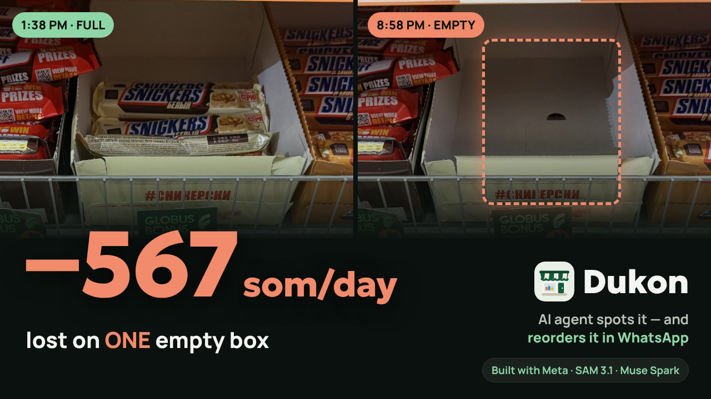
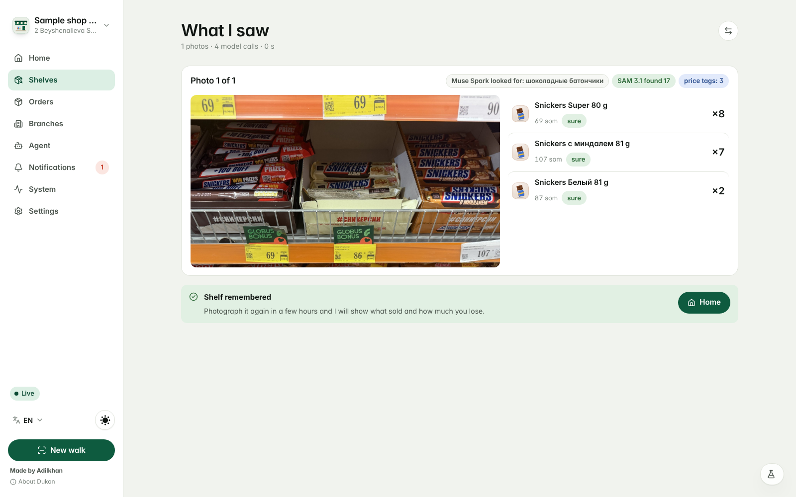
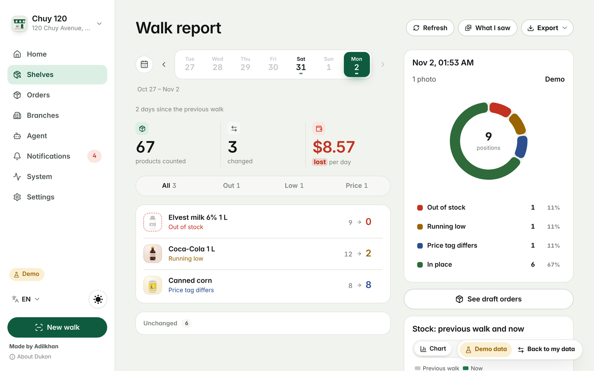
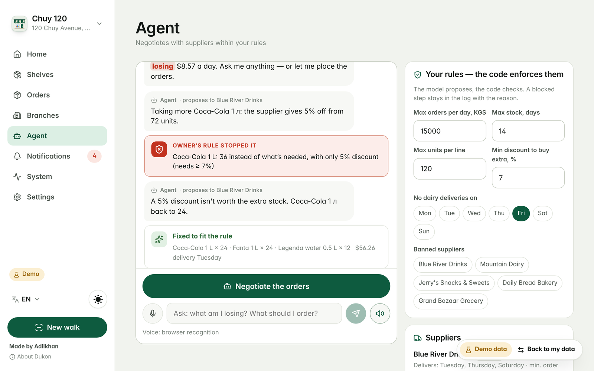

<p align="center">
  <a href="https://youtu.be/avagyzTkrYQ"></a>
</p>

<h1 align="center">Dukon</h1>
<p align="center"><b>Every empty shelf has a price. Dukon makes it visible — and refills it.</b></p>

<p align="center">
  <a href="https://dukon-woad.vercel.app"><b>▶ Try it live, no sign-up</b></a> ·
  <a href="https://youtu.be/avagyzTkrYQ"><b>🎬 Watch the 3-minute demo</b></a> ·
  Meta Global AI Developer Hackathon 2026 · Indie track · <i>Build for Your World</i>
</p>

<p align="center">
  
  
  
  
  
  
  
</p>

**Snap the shelf with a phone. Dukon finds every product, turns each empty spot into money lost per day, and sends an AI agent to restock it with your real suppliers in WhatsApp — inside rules the model cannot break.** Built solo in Bishkek, Kyrgyzstan, in ten days. Every line in this repository was written during the hackathon.

## The problem is global, and it is counted in trillions

- **$1.7 trillion a year.** That is what retail loses to empty and overstocked shelves — **6.2 % of all retail sales on Earth** ([IHL Group, 2026](https://www.ihlservices.com/?p=43092)).
- **1 product in 12** is missing from the shelf at any given moment. **1 shopper in 3** who meets an empty spot walks out and buys elsewhere (Gruen, Corsten & Bharadwaj, 2002).
- **Nearly half of all retail sales in Asia** and **46 % in Central America** still go through small traditional shops ([Nielsen](https://www.marketing-interactive.com/nielsen-reports-half-of-retail-sales-in-asia-made-at-traditional-corner-stores), [NielsenIQ](https://www.revistaeyn.com/empresasymanagement/el-canal-tradicional-concentra-el-46-de-las-ventas-de-consumo-masivo-en-centroamerica-JA31028881)). India alone has **12+ million** of them.

Big chains fight this with scanners, planograms and analysts. From Bishkek to Lagos to Mumbai, a corner shop has **one owner and one phone**. Nobody counts what is missing: the gap on the shelf quietly loses money every day until someone notices, calls the supplier and haggles.

**One empty box of Snickers in a Bishkek supermarket, measured by Dukon itself: 567 som (≈ $6.49) lost per day — almost $200 a month, from ONE box.** A corner shop has hundreds of boxes.

## What Dukon does

<table>
  <tr>
    <td width="33%" valign="top"><br><b>👁 Sees.</b> SAM 3.1 finds every pack and price tag; Muse Spark reads the name, count and price — in any language the packaging is in. No barcodes, no hardware, no training.</td>
    <td width="33%" valign="top"><br><b>💸 Counts the money.</b> Walks are compared over time: what sold, how fast, what ran out, and what each empty spot costs per day — with a counter that keeps running while the shelf stays empty.</td>
    <td width="33%" valign="top"><br><b>🤝 Negotiates.</b> A Muse Spark agent drafts the order per supplier and writes to a real person in WhatsApp. The model proposes, the code decides: the owner's rules are enforced in plain Python.</td>
  </tr>
</table>

| | |
|---|---|
| **Talks to real suppliers** | The order goes to the supplier in WhatsApp. They reply with one tap on a page the agent sends, or just write back — *"we can only deliver on Thursday"* — and the agent reads it, changes the order, reconfirms and closes the deal. Several rounds if needed. The owner only says yes. |
| **Listens in Kyrgyz** | The owner does not type. She asks *"Эмне заказ кылыш керек?"* — Muse Spark 1.2 hears the audio itself, because most speech tools do not speak Kyrgyz. Seven interface languages: en · ru · ky · kk · es · de · fr. |
| **Remembers prices** | Most corner shops have no price tags. Enter a price once, Dukon keeps it per shop and uses it for losses and orders. |
| **Runs the shop** | Branches on a map, a notification the moment something runs out, one tap to approve, PDF / Excel / CSV for the accountant, light and dark themes. No accounts — a device code, nothing to sign up for. |

## Try it in one minute

1. Open **https://dukon-woad.vercel.app** on your phone or laptop. No sign-up, no code.
2. Tap **Try it on a real shelf**. Two real photos of the same Bishkek shelf — an afternoon and an evening walk — go through SAM 3.1 and Muse Spark (the first run takes ~40 s, then it is cached). The report shows what ran out and what it costs per day.
3. Open **Agent → Negotiate the orders**. Watch the model propose, the owner's rule stop it, and the model fix itself.
4. Add your own supplier with a WhatsApp number, run the agent again, and answer the agent from the supplier's side on the page it sends — or in WhatsApp.
5. Press the microphone and ask *"what am I losing?"* in English, Russian, Kyrgyz or Kazakh.

Rather see the recorded chain of three branches? **See the demo** on the landing page works even if the server is down.

## Meta models

| Model | Where |
|---|---|
| **SAM 3.1** | finds every product and every price tag on the photo from concept prompts ("chocolate bar", "price tag") |
| **Muse Spark 1.3** | scouts the shelf and names the nouns for SAM; reads each numbered box (name, pack size, price in som); runs the ordering agent with tool calling; answers the owner's questions; parses free-text supplier replies into structure |
| **Muse Spark 1.2** (audio input) | hears Kyrgyz and Kazakh — the owner's own language |
| **Muse Voice Transcribe 1.0** | hears English, Spanish, German, French |
| **WhatsApp Cloud API** | the channel between the agent and a real supplier |

The idea in one line: **the model proposes, the code checks, the owner approves.** Every action the agent takes passes through the owner's rules in plain Python before anything reaches a supplier, and a blocked step stays in the log with its reason, so you see the rule fire.

## How it works

```
phone photos (HEIC ok) ─► JPEG ─► Muse Spark scouts: "what is on this shelf?" → 1–4 nouns for SAM
                                        │          ("chocolate bar", "toilet paper roll", "bar of soap")
                                        ▼
                          SAM 3.1 × each noun + "price tag"  (in parallel; boxes merged, duplicates dropped)
                                        │
                        no boxes? ──────┼──► Muse Spark counts without boxes, every item flagged "check"
                                        ▼
                          numbered overlay ─► Muse Spark reads each box: name, pack size, price in som
                                        │
                         previous walk ◄── SQLite ◄── shelves/items (renamed items matched by words+weight+price)
                              │
                              ▼
                     diff: sold, velocity, out-of-stock, price mismatch, loss per day  (+ owner prices)
                              │
                              ▼
                     draft orders by supplier (packs, delivery days, volume discounts)
                              │
                              ▼
        Muse Spark agent: propose_order → ask_supplier → confirm_order → finish   (tool calling)
                              │                ▲
                              ▼                │ every proposal
                     agent/verifier.py — the owner's rules, pure functions, blocks and explains
                              │
                              ▼
                     supplier answers in WhatsApp ─► owner approves ─► order sent
```

### Universal vision, not a Snickers demo

SAM 3.1 answers concept prompts, and only concrete nouns: on a real Bishkek shelf `packaged product` returned nothing, `chocolate bar` returned 40 boxes. So the pipeline never hardcodes a noun. Muse Spark looks at the photo first and names what is there in SAM's language; SAM finds every instance of each noun and every price tag; Spark reads the numbered boxes. If SAM finds nothing, Spark counts the items itself and every line is flagged for the owner to check — the report is never silently empty. Low-confidence lines are flagged too, and the model's own notes ("box 4 skipped — edge of the carton") stay in the report.

Names drift between calls ("Snickers 80 g" vs "Snickers more peanuts 81 g"), which would turn one product into "sold out + new item". `backend/app/domain/diff.py` matches items across walks by product words, pack weight (±6 %) and price, and keeps the earlier key as the item's identity over time.

### Reliability: the same shelf twice must cost nothing

Vision models are not deterministic: the same shelf read twice differs by a unit or two and by a word in a name. Without guards that became "sold 10 bars in 2 minutes" — a million som a day of imaginary loss. Four guards:

1. **Vocabulary.** Muse Spark gets the product names from the previous walk and is told to reuse them word for word.
2. **Noise threshold.** A drop of one unit or under 10 % is reading noise, not a sale.
3. **Minimum interval.** Under six hours between walks velocity is not measured. A product that was on the shelf and is now gone is still a loss: the report then assumes the facing sells out in a week, marks the number as an *estimate* and suggests restoring the facing rather than ordering two weeks of guessed sales.
4. **Capture time from EXIF.** A walk is dated by when the photos were taken, not when they were uploaded.

`python -m scripts.bench_vision photo.heic --stability` reads a photo twice and diffs the reads as walks 12 hours apart. Expected: **0 som/day, 0 changes**.

## The agent

`POST /agent/run?walk_id=` starts a negotiation for the latest walk and streams the journal over SSE. The agent is Muse Spark with five tools (`backend/app/agent/workbench.py`):

| tool | what the code does |
|---|---|
| `propose_order` | rounds quantities to packs and runs **every owner's rule** (`agent/verifier.py`); on a violation returns `blocked` with the rule, the limit and a fix hint — the model must correct itself |
| `ask_supplier` | a **live supplier** gets the order in WhatsApp and the agent waits for the answer; a sample supplier is answered by a simulator that behaves like a sales rep: out-of-stock lines, the minimum order, the volume discount, the delivery day and a "take more and get 5 %" counter-offer |
| `confirm_order` | builds the order from the supplier's reply and runs the rules again |
| `skip_item`, `say`, `finish` | explain, skip, finish; `finish` checks the daily total across all suppliers |

Owner's rules, per shop, editable in the UI or by talking to the agent: max order total per day, max days of stock per item, max units per line, no dairy deliveries on chosen weekdays, banned suppliers, a minimum discount before buying more than needed. They are pure functions with a test per rule, so the model cannot talk its way around them — and neither can the owner: `POST /orders/approve` runs the same checks.

**Live suppliers in WhatsApp.** The owner adds suppliers with real WhatsApp numbers on the Agent screen. When the agent calls `ask_supplier` for one of them it opens a conversation (`agent/channel.py`): the order goes to the supplier in the run's language with a one-tap reply link (`/s/<token>`, no login — the link is the secret, 72 h); the journal shows a *waiting* card with **Open in WhatsApp**, or the server sends the message itself through the **WhatsApp Cloud API** when it is configured. The supplier answers with a button (all in stock / some items out / another day / cannot deliver) or in free text, on the page or straight in the WhatsApp chat (`POST /whatsapp/webhook`, signature-checked, matched to the open conversation by phone number). `agent/replies.py` turns the text into the same structure the simulator produces — weekdays in four languages, "Fanta is out", "5 % from 100 units", "below our minimum" — with Muse Spark as a JSON-schema fallback for sentences the rules do not understand; the verifier then runs on it exactly as on a simulated reply. When the agent confirms, the supplier sees the final order in the same conversation. If the supplier is silent or WhatsApp is down, the run does not hang: after a timeout the simulator answers, the owner still gets an order, and a late reply lands in the conversation log. A negotiation can take several rounds with the same supplier — for example, the supplier moves the delivery to Thursday and the agent asks to reconfirm — and every round gets its own reply link.

> **About WhatsApp in the demo video.** The Cloud API path is implemented and covered by tests: sending, the signed webhook and reply matching. Meta's Graph API accepted every send (`wamid…`), but during the hackathon Meta restricted my brand-new, not yet verified WhatsApp Business account (`health_status`: WABA *BANNED*, error 141014), so messages were not delivered. In the video the same order therefore goes out through the **reply-link channel**: Dukon writes the message, the owner sends it from her own WhatsApp with one tap, and the supplier — a real person — answers on the link. Once the business account is verified, the server sends the message itself with no code changes.

**Conversation and voice.** `POST /agent/chat` answers questions about the walk and can change a rule or start the negotiation from a sentence ("no dairy on Friday", "order everything"). The agent answers in the language of the question, not of the interface. On the Agent screen the owner can speak: the recording stops by itself after three seconds of silence; Kyrgyz and Kazakh go to Muse Spark 1.2 with audio (with the shop's product names as hints), the other languages to Muse Voice Transcribe or the browser. Replies are read aloud in the reply's language; for Kyrgyz the nearest Cyrillic voice is used with ө/ү/ң mapped to letters it can say.

**Prices without price tags.** Many corner shops have none. Open a product, enter its price once — Dukon keeps it per shop and uses it for losses and orders. A price tag on the shelf, when there is one, always wins.

## Frontend

React 19, TypeScript strict, `motion`, ECharts, MapLibre, seven languages (en, ru, ky, kk, es, de, fr), light and dark themes, PDF/Excel/CSV export, a map of branches, a walk calendar, and a few things that move on their own: a "lost today so far" counter, "3 min ago" labels that age, a pulsing live dot. Animations respect the device's reduce-motion setting.

There are no accounts. The browser creates a device code once; shops, walks, photos, suppliers, prices, agent runs and orders belong to that code. Enter the same code on another phone in Settings to see the same shops. When the server has no key or credits, or does not answer at all, the app shows a recorded demo chain from a bundled snapshot instead of an error page, and returns to live data on its own when the server is back.

## Security

A self-review with proof-of-concept requests, each with a test in `backend/tests/test_isolation.py`:

- **Tenant isolation.** Listing, reading, comparing and deleting walks, agent runs, drafts, chat, orders, suppliers and prices answer only for the owning device; a foreign id gets `404`, so ids cannot be probed. Demo data stays public.
- **Signed photo links.** Photos are served only through an HMAC-signed URL bound to the hash and to `PHOTO_URL_SECRET`.
- **Credit protection.** Per-device, per-IP and daily limits on live model calls; `X-Forwarded-For` is trusted only behind a real proxy. Open access for judges (`OPEN_ACCESS=true`) keeps all three limits; a `DEMO_KEY` lifts the per-device one for the author.
- **Supplier pages** are public by link only (192-bit token, 72 h) and rate-limited; the WhatsApp webhook checks `X-Hub-Signature-256`.
- **Exports.** CSV cells starting with `= + - @` are neutralised.
- **Headers.** `nosniff`, `X-Frame-Options: DENY`, `Referrer-Policy: no-referrer`, `frame-ancestors 'none'`.
- Owner rules are enforced by code, not by the model, and re-checked on approval; uploads reject non-images, decompression bombs and oversize files; `pip-audit` and `npm audit` are clean.

## Run locally

```powershell
# backend (Windows PowerShell, conda)
cd backend
conda create -n dukon python=3.12 -y
conda activate dukon
pip install -r requirements-dev.txt
uvicorn app.api:app --reload --port 8000      # http://localhost:8000/docs

# frontend
cd frontend
npm install
npm run dev                                     # http://localhost:5173
```

Without a key the backend runs on a deterministic mock provider with demo walks: every screen works, including the agent. For live models create `backend/.env` (git-ignored):

```ini
PROVIDER=meta
MODEL_API_KEY=your-meta-key
DEMO_KEY=choose-a-code                  # lifts the per-device limit for the author
OPEN_ACCESS=true                        # judges need no code; per-device, per-IP and daily limits still apply
PHOTO_URL_SECRET=any-long-random-string
TRUST_FORWARDED_FOR=false               # true only behind a real proxy (Render, Vercel)
CORS_ORIGINS=http://localhost:5173
PUBLIC_BASE_URL=http://localhost:5173   # where suppliers open the reply link
SUPPLIER_REPLY_TIMEOUT_S=180
# optional — WhatsApp Cloud API; without it the agent works through wa.me links
WHATSAPP_TOKEN=
WHATSAPP_PHONE_ID=
WHATSAPP_VERIFY_TOKEN=choose-any-string
WHATSAPP_APP_SECRET=
```

Optional `frontend/.env`: `VITE_API_URL=http://localhost:8000` (the default).

**Deploy.** `render.yaml` describes the backend (always-on instance, persistent disk for the database and photos); `frontend/vercel.json` the frontend. Set `VITE_API_URL` on Vercel and `CORS_ORIGINS` / `PUBLIC_BASE_URL` on Render to each other's domains.

## Tests

```powershell
cd backend;  python -m pytest -q;  ruff check app tests
cd frontend; npm run check        # typecheck + lint + tests + build
```

192 backend tests, 275 frontend tests: the vision pipeline on fixtures, the diff guards, every owner's rule, the agent loop with a scripted brain, live supplier conversations and reply parsing, the WhatsApp webhook, tenant isolation, exports, and the UI in seven languages.

## Where this goes next

Dukon works today on one shelf in Bishkek. The pipeline is shelf-agnostic by design, and the next steps are already mapped:

| Next | What it unlocks |
|---|---|
| 🎥 **Video walks** | Walk the aisle with the camera on — SAM 3.1 tracks every pack frame by frame, no photos to pick. |
| 🕶️ **Ray-Ban Meta glasses** | The owner looks at the shelf and asks what she is losing. Hands free, no phone out. |
| ⚔️ **Price race** | Several suppliers compete in WhatsApp for every order — the shop always gets the best deal. |
| 🏪 **Pilot in real corner shops** | Starting in Bishkek, with the shops the product was built for; then every market where shops still run on guesswork. |

Millions of small shops run on guesswork. Dukon turns guesswork into money they can see.

## Repository

```
backend/   FastAPI · Python 3.12 · SQLite · provider adapters (meta / mock) · agent · WhatsApp
frontend/  React 19 · Vite · TypeScript · vitest · motion · ECharts · MapLibre · i18n
assets/    screenshots for this page
```

Made by [Adilkhan Dzhanteliev](https://github.com/AdilkhanEEAIR), Bishkek. MIT license.
